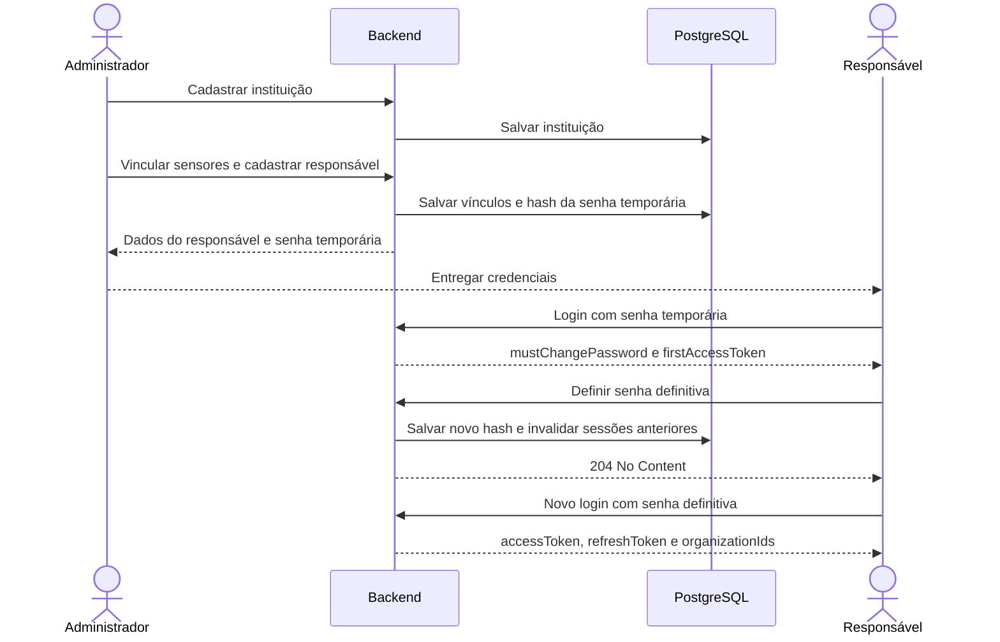

# Instituições, responsáveis, sensores e primeiro acesso

Este guia descreve o comportamento implementado no UrbanShade. Ele serve como referência para a equipe de backend, aplicativo e testes.

## 1. Visão geral

A instituição representa o cliente atendido pela UrbanShade, como uma prefeitura, condomínio, órgão público ou empresa. O responsável é uma pessoa com conta própria, vinculada a uma ou mais instituições.

O administrador da plataforma cadastra a instituição, vincula os sensores e cria ou associa os responsáveis. Quando o responsável ainda não possui conta, o backend gera uma senha temporária e exige sua substituição no primeiro acesso.

Não existe envio automático de e-mail neste fluxo. O administrador entrega as credenciais ao responsável pelo canal combinado com o cliente.



## 2. Conceitos e permissões

| Conceito | Responsabilidade |
|---|---|
| `Organization` | Dados cadastrais e situação da instituição |
| `OrganizationMember` | Vínculo entre um usuário e uma instituição |
| `Sensor.OrganizationId` | Instituição à qual o sensor está associado |
| `PlatformAdministrator` | Administração das instituições, responsáveis e vínculos de sensores |
| `Manager` | Consulta dos recursos das instituições às quais está vinculado |
| `Citizen` | Consulta dos recursos públicos previstos nos módulos de sensores e medições |

Uma instituição pode possuir vários sensores e responsáveis. Um responsável pode estar vinculado a várias instituições.

O cadastro público `POST /api/auth/register` cria contas `Citizen` e retorna `202` genérico, sem tokens; depois o cliente chama login. A role enviada pelo cliente não concede privilégios administrativos. Para executar os passos administrativos deste guia, utilize uma conta já provisionada como `PlatformAdministrator`.

## 3. Preparar o ambiente e o Swagger

1. Execute a API com a configuração de banco e JWT do ambiente.
2. Na inicialização, as migrations pendentes são aplicadas automaticamente.
3. Em Development, abra o Swagger. Pelos perfis atuais, ele está em `http://localhost:5289/swagger` ou `https://localhost:7202/swagger`.
4. Faça login com a conta administrativa em `POST /api/auth/login`.
5. Copie `data.accessToken`.
6. Clique em **Authorize**, cole somente o token, sem o prefixo `Bearer`, e confirme.

Fora do Swagger, envie o header:

```http
Authorization: Bearer <accessToken>
Content-Type: application/json
```

O token de primeiro acesso será usado de forma semelhante, mas somente na rota específica de definição da senha.

Depois de atualizar o backend para esta implementação, faça um novo login para obter os novos campos do JWT.

## 4. Cadastrar a instituição

**Permissão:** `PlatformAdministrator`.

```http
POST /api/organizations
```

```json
{
  "name": "Prefeitura de Demonstração",
  "type": "Municipality",
  "document": "DEMO-PREFEITURA-001",
  "contactEmail": "contato@example.com",
  "contactPhone": "11999999999"
}
```

O documento do exemplo é fictício e serve apenas para demonstração.

| Campo | Regra |
|---|---|
| `name` | Obrigatório, até 150 caracteres após remover espaços nas extremidades |
| `type` | Nome exato de um valor da tabela abaixo |
| `document` | Obrigatório, único, até 30 caracteres |
| `contactEmail` | E-mail válido, até 254 caracteres |
| `contactPhone` | Opcional, até 30 caracteres |

| Valor de `type` | Uso |
|---|---|
| `Municipality` | Prefeitura |
| `Condominium` | Condomínio |
| `PublicAgency` | Órgão público |
| `Company` | Empresa |
| `Other` | Outra instituição |

O documento é normalizado com remoção de espaços nas extremidades e conversão para maiúsculas. A implementação atual não valida CNPJ nem remove sua pontuação: a equipe deve manter um padrão de preenchimento.

**Resposta:** `201 Created`, com a instituição em `data`. Guarde `data.id`; ele será o `organizationId` das próximas etapas.

A instituição é criada ativa. Para consultar:

```http
GET /api/organizations
GET /api/organizations/{organizationId}
```

O administrador visualiza todas as instituições. O responsável visualiza somente aquelas que estão ativas e possuem vínculo ativo com sua conta. Uma conta `Citizen` recebe lista vazia na listagem.

## 5. Cadastrar e vincular sensores

O sensor precisa existir antes de ser vinculado. Se necessário, o administrador o cadastra:

```http
POST /api/sensors
```

```json
{
  "code": "DEMO-SENSOR-001",
  "name": "Sensor Praça Central",
  "description": "Sensor de demonstração da instituição",
  "latitude": -22.2935,
  "longitude": -44.9332
}
```

Guarde o `data.id` retornado como `sensorId`. Em seguida:

```http
POST /api/organizations/{organizationId}/sensors/{sensorId}
```

**Permissão:** `PlatformAdministrator`. Não é necessário enviar corpo.

**Resposta:** `204 No Content`.

Regras:

- A instituição deve estar ativa.
- O sensor deve existir e não estar excluído.
- Sensores existentes e de demonstração podem permanecer sem instituição até serem associados.
- Repetir a associação à mesma instituição é permitido.
- Associar um sensor já vinculado a outra instituição retorna `409 Conflict`.
- A transferência entre instituições não está disponível no MVP.
- A associação não altera o status operacional do sensor.
- A geração de medições continua seguindo o status `ACTIVE` e a configuração de simulação.

## 6. Cadastrar o responsável

**Permissão:** `PlatformAdministrator`. A instituição deve estar ativa.

```http
POST /api/organizations/{organizationId}/members
```

```json
{
  "name": "Responsável de Demonstração",
  "email": "responsavel@example.com"
}
```

### Quando o e-mail ainda não possui conta

O backend cria o usuário como `Manager`, cria o vínculo e retorna `201 Created`.

Exemplo de resposta, com valores ilustrativos:

```json
{
  "data": {
    "organizationId": "11111111-1111-4111-8111-111111111111",
    "user": {
      "id": "22222222-2222-4222-8222-222222222222",
      "name": "Responsável de Demonstração",
      "email": "responsavel@example.com",
      "role": "Manager"
    },
    "temporaryPassword": "<senha-gerada-pela-api>",
    "temporaryPasswordExpiresAt": "12/11/2026 13:00"
  },
  "status": "Success",
  "messages": []
}
```

A senha temporária é retornada somente nessa operação administrativa. Ela não pode ser consultada depois pela listagem de responsáveis. O banco armazena somente o hash.

O administrador deve entregar ao responsável seu e-mail e a senha temporária retornada. Não há envio de e-mail pelo backend.

### Quando o e-mail já possui conta

- O backend preserva o nome da conta existente. Ao promover uma conta `Citizen`, substitui a senha, revoga as sessões e exige primeiro acesso com a nova credencial entregue pelo administrador.
- Uma conta `Citizen` passa a `Manager`, com nova senha temporária.
- Uma conta administrativa mantém a role `PlatformAdministrator`.
- Para contas que já são `Manager` ou `PlatformAdministrator`, `temporaryPassword` e `temporaryPasswordExpiresAt` retornam `null`; as credenciais existentes são preservadas.
- Uma conta inativa não pode ser associada; a operação retorna `409 Conflict`.
- Um vínculo já ativo retorna `409 Conflict`.
- Um vínculo anteriormente removido pode ser reativado por essa mesma operação.

Se a conta já era `Manager` e tem senha definitiva, o responsável usa sua senha atual. Se ainda está em primeiro acesso por outro vínculo, utiliza a credencial temporária que já recebeu.

O usuário deve fazer novo login após uma mudança de role. As instituições presentes no token são atualizadas no login e no refresh.

## 7. Fazer o primeiro login

O responsável chama:

```http
POST /api/auth/login
```

```json
{
  "email": "responsavel@example.com",
  "password": "<senha-temporaria-recebida>"
}
```

Exemplo de resposta:

```json
{
  "data": {
    "mustChangePassword": true,
    "firstAccessToken": "<jwt-restrito-de-primeiro-acesso>",
    "firstAccessTokenExpiresAt": "11/11/2026 13:10",
    "organizationIds": [],
    "accessToken": "",
    "accessTokenExpiresAt": "",
    "refreshToken": "",
    "refreshTokenExpiresAt": "",
    "user": {
      "id": "22222222-2222-4222-8222-222222222222",
      "name": "Responsável de Demonstração",
      "email": "responsavel@example.com",
      "role": "Manager"
    }
  },
  "status": "Success",
  "messages": []
}
```

O aplicativo deve verificar `data.mustChangePassword` antes de navegar para sua área principal. Quando for `true`, deve abrir a tela de definição da senha e usar `data.firstAccessToken`.

Esse JWT possui `purpose = first_access` e não autoriza acesso às rotas comuns, institucionais ou administrativas. Não é emitido refresh token nessa etapa.

A senha temporária permanece válida até a troca ser concluída, sua expiração ou sua regeneração administrativa. Se somente o token curto expirar, o responsável pode repetir o login enquanto a senha temporária estiver válida.

## 8. Definir a senha definitiva

```http
POST /api/auth/first-access/password
Authorization: Bearer <firstAccessToken>
```

```json
{
  "newPassword": "Nova-senha-de-demonstracao-2026!"
}
```

No Swagger, substitua o token do **Authorize** pelo `firstAccessToken` antes dessa chamada.

A nova senha:

- Deve conter pelo menos 12 caracteres.
- Deve ocupar no máximo 1024 bytes em UTF-8.
- Deve ser diferente da senha temporária.

Não é necessário enviar `currentPassword` no primeiro acesso.

**Resposta:** `204 No Content`, sem corpo JSON.

Ao concluir:

- O hash da senha definitiva substitui o da senha temporária.
- A exigência de troca é removida.
- A versão de segurança da conta é incrementada.
- Credenciais temporárias e tokens anteriores deixam de autorizar acesso.
- Sessões de refresh anteriores são revogadas.

O token utilizado não pode concluir a operação novamente. O aplicativo deve limpar o token de primeiro acesso e voltar à tela de login.

## 9. Login normal e contexto institucional no JWT

Faça novo login com o mesmo e-mail e a senha definitiva.

A resposta terá:

- `mustChangePassword = false`.
- `firstAccessToken = null`.
- `firstAccessTokenExpiresAt = null`.
- `accessToken` e `refreshToken` preenchidos.
- `organizationIds` com os vínculos ativos em instituições ativas.

O JWT normal contém, entre outras informações:

```json
{
  "sub": "22222222-2222-4222-8222-222222222222",
  "role": "Manager",
  "purpose": "access",
  "security_version": 2,
  "organization_ids": [
    "11111111-1111-4111-8111-111111111111"
  ]
}
```

A versão numérica é ilustrativa; ela varia conforme as operações realizadas na conta.

O aplicativo pode usar os IDs como contexto para apresentar o seletor de instituições, mas deve buscar os dados atuais em `GET /api/organizations`.

A autorização institucional consulta o banco para verificar a role atual, a situação da instituição e o vínculo. Um JWT antigo que ainda contenha o ID de uma instituição não mantém o acesso após a remoção do vínculo.

A autenticação também valida no banco a existência e situação da conta, sua versão de segurança e a compatibilidade entre a role atual e o token.

## 10. Consultas institucionais

Utilize o `accessToken` normal:

| Método e rota | Resultado |
|---|---|
| `GET /api/organizations` | Instituições visíveis ao usuário |
| `GET /api/organizations/{id}` | Dados da instituição |
| `GET /api/organizations/{id}/members` | Responsáveis com vínculo ativo |
| `GET /api/organizations/{id}/sensors` | Sensores associados e não excluídos |
| `GET /api/organizations/{id}/sensors/{sensorId}/readings` | Histórico paginado de um sensor da instituição |
| `GET /api/organizations/{id}/sensors/{sensorId}/readings/latest` | Última medição do sensor |

O histórico aceita `startDate`, `endDate`, `page` e `pageSize`. A página padrão é 1, o tamanho padrão é 20 e o máximo é 100. As datas enviadas com offset são convertidas para UTC.

Exemplo:

```http
GET /api/organizations/{id}/sensors/{sensorId}/readings?startDate=2026-11-11T00:00:00Z&endDate=2026-11-11T23:59:59Z&page=1&pageSize=20
```

O histórico fica em `data.items`, com `page`, `pageSize` e `totalItems` em `data`. A ordenação começa pelas medições mais recentes.

O responsável pode consultar sensores inativos ou em manutenção de sua instituição por essas rotas. Sensores excluídos não aparecem nas consultas institucionais. O histórico de sensores excluídos permanece disponível ao administrador pela rota global `GET /api/sensors/{id}/readings`.

Uma instituição ou um sensor fora do escopo do usuário retorna `404 Not Found`. A última leitura de um sensor visível que ainda não possui medições retorna `204 No Content`.

Os endpoints públicos autenticados de sensores e medições mantêm suas regras atuais: usuários comuns consultam sensores ativos. O vínculo institucional não torna automaticamente privado um sensor desses endpoints.

## 11. Atualizar ou desativar uma instituição

**Permissão:** `PlatformAdministrator`.

```http
PUT /api/organizations/{organizationId}
```

Envie todos os campos cadastrais; trata-se de uma atualização completa:

```json
{
  "name": "Prefeitura de Demonstração",
  "type": "Municipality",
  "document": "DEMO-PREFEITURA-001",
  "contactEmail": "contato@example.com",
  "contactPhone": "11999999999",
  "active": false
}
```

**Resposta:** `200 OK`, com os dados atualizados em `data`.

Uma instituição inativa deixa de ser acessível aos seus responsáveis, inclusive com JWT emitido antes da desativação. O administrador continua podendo consultá-la e reativá-la.

A desativação preserva usuários, vínculos, sensores e medições. Ela não altera automaticamente o status dos sensores nem interrompe a simulação de sensores que continuam `ACTIVE`.

## 12. Remover o vínculo de um responsável

**Permissão:** `PlatformAdministrator`.

```http
DELETE /api/organizations/{organizationId}/members/{userId}
```

**Resposta:** `204 No Content`.

A remoção desativa o vínculo e preserva a conta. O usuário pode continuar acessando outras instituições às quais esteja vinculado e os recursos públicos permitidos.

A role `Manager` não é revertida automaticamente para `Citizen`. Sem vínculos ativos, a listagem institucional fica vazia.

Um login ou refresh posterior atualiza os IDs institucionais presentes no token.

## 13. Regenerar uma senha temporária

Use quando a senha temporária foi perdida ou expirou e o primeiro acesso ainda não foi concluído.

**Permissão:** `PlatformAdministrator`. A instituição e o vínculo devem estar ativos.

```http
POST /api/organizations/{organizationId}/members/{userId}/temporary-password
```

Não é necessário enviar corpo.

**Resposta:** `200 OK`, no mesmo formato da resposta de cadastro de responsável, com uma nova `temporaryPassword`.

A operação invalida a senha temporária e os tokens de primeiro acesso anteriores. A nova senha é exibida somente nessa resposta.

Depois de o usuário definir sua senha definitiva, essa operação retorna `409 Conflict`. Ela não implementa recuperação de senha de contas que já concluíram o primeiro acesso.

## 14. Troca normal de senha

Disponível para usuários autenticados com um `accessToken` normal, incluindo cidadãos, responsáveis e administradores.

```http
PUT /api/auth/password
Authorization: Bearer <accessToken>
```

```json
{
  "currentPassword": "Nova-senha-de-demonstracao-2026!",
  "newPassword": "Outra-senha-de-demonstracao-2026!"
}
```

A nova senha segue as mesmas regras do primeiro acesso e deve ser diferente da atual.

**Resposta:** `204 No Content`.

Todos os tokens anteriores da conta ficam inválidos. O aplicativo deve limpar a sessão local e solicitar novo login com a nova senha.

## 15. Renovação e saída da sessão

### Renovar

```http
POST /api/auth/refresh
```

```json
{
  "refreshToken": "<refreshToken-atual>"
}
```

A resposta é um novo `AuthenticationResponse`. Substitua os dois tokens locais pelos novos valores: o refresh token anterior não deve ser reutilizado.

O refresh consulta a role e os vínculos atuais para atualizar o contexto institucional. Contas que exigem troca de senha não podem renovar sessões normais.

### Sair

```http
POST /api/auth/logout
```

```json
{
  "refreshToken": "<refreshToken-da-sessao>"
}
```

A resposta é `204 No Content` e a família de refresh tokens é revogada. O aplicativo também deve apagar seus tokens locais.

A saída não incrementa a versão de segurança da conta; um access token já emitido pode continuar válido até sua expiração. A troca de senha invalida também os access tokens anteriores.

## 16. Datas e configuração

As datas de expiração retornadas em autenticação e provisionamento usam o formato `dd/MM/yyyy HH:mm` e representam UTC, embora a string não tenha sufixo de fuso. O aplicativo deve considerar esse contrato ao exibir horários.

As medições climáticas continuam usando ISO 8601 em UTC, com `Z`.

Configuração padrão:

```json
{
  "FirstAccess": {
    "TemporaryPasswordHours": 24,
    "TokenMinutes": 10
  }
}
```

Os limites aceitos são de 1 a 168 horas para a senha temporária e de 1 a 60 minutos para o token de primeiro acesso. A validade do token não ultrapassa a validade restante da senha temporária.

A configuração é carregada na inicialização. Reinicie a API após alterá-la.

## 17. Tratamento de erros no aplicativo

| HTTP | Significado neste fluxo | Tratamento esperado |
|---|---|---|
| `200` | Consulta ou atualização concluída | Ler `data` |
| `201` | Instituição, conta ou vínculo cadastrado | Guardar IDs; apresentar a credencial temporária quando retornada |
| `204` | Operação sem conteúdo ou ausência de última leitura | Não tentar desserializar um corpo JSON |
| `400` | Campos inválidos, senha inadequada ou filtro inválido | Apresentar `messages` |
| `401` | Credencial, conta ou sessão inválida/expirada | Renovar apenas uma sessão normal elegível ou solicitar login |
| `403` | Token válido sem permissão ou finalidade adequada | Bloquear a ação; conferir role e tipo de token |
| `404` | Instituição, vínculo ou sensor inexistente/inacessível | Atualizar a seleção e não presumir acesso pelo JWT |
| `409` | Documento/vínculo duplicado, transferência de sensor ou regeneração indevida | Apresentar a causa e revisar a operação |

Respostas de erro usam o envelope:

```json
{
  "status": "Error",
  "messages": [
    "Mensagem retornada pelo backend."
  ]
}
```

Nos desafios de autenticação, `status` pode ser `Unauthorized`. O status HTTP deve orientar o tratamento.

## 18. Roteiro de validação da equipe

1. Autenticar um administrador.
2. Cadastrar uma instituição e um sensor.
3. Associar o sensor à instituição.
4. Criar um responsável novo e guardar a senha temporária.
5. Confirmar que o primeiro login retorna `mustChangePassword = true`, sem access token normal nem refresh token.
6. Confirmar que o token de primeiro acesso recebe `403` em uma rota comum.
7. Definir a senha definitiva e confirmar `204`.
8. Confirmar que a senha temporária e o token de primeiro acesso antigos são recusados.
9. Fazer login normal e consultar a instituição, seus sensores e suas medições.
10. Tentar consultar outra instituição sem vínculo e confirmar `404`.
11. Remover o vínculo pelo administrador e confirmar que o JWT antigo não mantém o acesso institucional.
12. Trocar uma senha normal e confirmar que as sessões anteriores foram invalidadas.
13. Criar outro responsável pendente, regenerar sua senha temporária e confirmar que as credenciais anteriores deixaram de funcionar.

## 19. Referências no código

- [Rotas institucionais](../Backend/UrbanShade.API/Controllers/OrganizationsController.cs).
- [Rotas de autenticação e senhas](../Backend/UrbanShade.API/Controllers/AuthenticationController.cs).
- [Validação do JWT e políticas de acesso](../Backend/UrbanShade.API/Authentication/BearerConfiguration.cs).
- [Autorização institucional com consulta ao banco](../Backend/UrbanShade.Application/UseCases/Organizations/OrganizationAccess.cs).
- [Provisionamento e regeneração de credenciais](../Backend/UrbanShade.Application/UseCases/Organizations/Members/OrganizationMembersUseCase.cs).
- [Troca de senha e invalidação de sessões](../Backend/UrbanShade.Application/UseCases/Authentication/ChangePassword/ChangePasswordUseCase.cs).
- [Testes de integração do fluxo](../../tests/WebApi.Tests/Organizations/OrganizationTests.cs).
