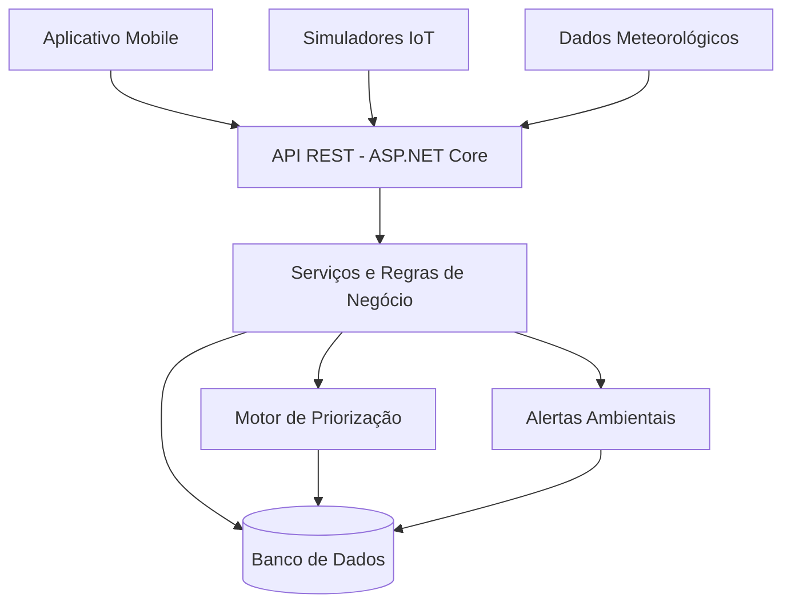

# 🌳 UrbanShade

### Inteligência climática para cidades mais habitáveis

**Global Solution 2026/2 — FIAP | Engenharia de Software**

> Transformando dados ambientais em decisões inteligentes para combater os efeitos do calor urbano e construir cidades mais sustentáveis.

---

## 📖 Sobre o projeto

O **UrbanShade** é uma plataforma de inteligência climática urbana desenvolvida para monitorar condições ambientais, identificar áreas com maior exposição ao calor e auxiliar gestores públicos na priorização de intervenções urbanas.

A solução combina dados meteorológicos, sensores IoT, geolocalização e algoritmos de análise para apoiar decisões relacionadas à arborização, ao sombreamento e à melhoria do conforto térmico da população.

O projeto está sendo desenvolvido como parte da **Global Solution 2026/2 da FIAP**, cujo tema é *CitizenTech — Tecnologia com o cidadão no centro da inovação*.

## 🎯 O problema

O crescimento urbano, a impermeabilização do solo e a redução da cobertura vegetal contribuem para a formação de ilhas de calor.

Ruas com pouca arborização e grandes superfícies asfaltadas podem apresentar condições térmicas significativamente diferentes de regiões com vegetação e sombreamento.

Essa realidade afeta especialmente:

- Pessoas idosas e crianças;
- Trabalhadores expostos ao sol;
- Pedestres e usuários do transporte público;
- Pessoas que precisam acessar escolas, hospitais e outros serviços essenciais.

Além disso, municípios com recursos limitados enfrentam dificuldades para determinar quais regiões devem receber investimentos prioritários em infraestrutura verde.

**Como ajudar uma cidade a identificar onde intervenções contra o calor urbano podem beneficiar mais pessoas?**

Essa é a pergunta que o UrbanShade busca responder.

## 💡 Nossa solução

O UrbanShade propõe uma plataforma de monitoramento e apoio à decisão, dividida em três módulos principais.

### 🌡️ 1. Monitoramento ambiental

Coleta e processamento de informações climáticas provenientes de sensores IoT simulados e fontes meteorológicas externas.

Funcionalidades planejadas:

- Monitoramento de temperatura e umidade;
- Registro histórico de medições;
- Identificação de condições térmicas desfavoráveis;
- Geração automática de alertas;
- Consulta de dados ambientais por localização.

### 🗺️ 2. Mapeamento climático

Visualização geográfica dos pontos monitorados, permitindo identificar regiões que necessitam de maior atenção.

Funcionalidades planejadas:

- Mapa interativo com pontos de monitoramento;
- Indicadores ambientais por localização;
- Identificação de áreas prioritárias;
- Visualização de alertas;
- Consulta do histórico de medições.

As informações serão identificadas conforme sua origem: dados reais, estimativas ou simulações.

### 🧠 3. Priorização inteligente

Um mecanismo de análise multicritério destinado a apoiar decisões de planejamento urbano.

O algoritmo considerará fatores como:

- Indicadores de exposição ao calor;
- Disponibilidade de arborização e sombreamento;
- Circulação estimada de pessoas;
- Proximidade de escolas, hospitais e pontos de transporte;
- Vulnerabilidade dos grupos beneficiados.

Com base nesses fatores, o sistema calculará um **índice de prioridade de intervenção**, permitindo comparar diferentes regiões e justificar as recomendações apresentadas.

O objetivo não é substituir especialistas em planejamento urbano, mas fornecer informações para apoiar decisões mais transparentes e fundamentadas.

## 👥 Público-alvo

### Cliente principal

**Prefeituras municipais**, especialmente por meio das Secretarias de Meio Ambiente, Urbanismo e Planejamento.

A plataforma poderá apoiar a identificação de regiões prioritárias e o planejamento de investimentos em infraestrutura verde.

### Usuários

**Gestores públicos:** consultam informações ambientais, monitoram indicadores e avaliam prioridades de intervenção.

**Cidadãos:** acompanham as condições ambientais dos locais monitorados e recebem informações e alertas relevantes.

O modelo de negócio proposto é **B2G (Business to Government)**, com possibilidade futura de licenciamento para outras organizações.

## ⚙️ Arquitetura

O projeto seguirá uma arquitetura cliente-servidor, com separação de responsabilidades entre aplicativo, API, banco de dados e simuladores IoT.



### Tecnologias planejadas

| Camada | Tecnologia |
|---|---|
| Backend | C# / ASP.NET Core |
| API | RESTful / JSON |
| Banco de dados | PostgreSQL |
| ORM | Entity Framework Core |
| Frontend mobile | A definir conforme as tecnologias permitidas pela FIAP |
| IoT | Sensores simulados com integração HTTP |
| Integração meteorológica | Open-Meteo |
| Autenticação | JWT e controle de acesso por perfis |
| Documentação da API | Swagger / OpenAPI |
| Testes | xUnit e testes de integração |

*As tecnologias poderão ser ajustadas durante o desenvolvimento para atender ao conteúdo curricular exigido pela Global Solution.*

## 🗄️ Modelagem de dados

O modelo relacional inicial contempla as seguintes entidades:

| Entidade | Responsabilidade |
|---|---|
| `Users` | Usuários, credenciais e perfis |
| `Locations` | Locais geográficos monitorados |
| `Sensors` | Sensores associados a cada local |
| `SensorReadings` | Histórico de medições ambientais |
| `Alerts` | Alertas gerados pelas medições |
| `Interventions` | Propostas de intervenções urbanas |

A modelagem deverá garantir integridade referencial, normalização e consistência das informações.

## 📱 Aplicativo mobile

O aplicativo será desenvolvido para oferecer acesso simplificado às informações do UrbanShade.

### Telas planejadas

1. **Login:** autenticação e acesso seguro.
2. **Mapa ambiental:** visualização de locais monitorados e alertas.
3. **Detalhes do local:** indicadores, histórico e informações ambientais.
4. **Alertas:** consulta de ocorrências e condições desfavoráveis.
5. **Gestão de locais:** funcionalidades administrativas para cadastro e manutenção.

As telas consumirão a API REST, com tratamento de erros de conexão e feedback ao usuário.

## 📡 Simulação de IoT

O UrbanShade utilizará pelo menos dois sensores simulados:

**Sensor de temperatura:** responsável pelo envio de medições em graus Celsius.

**Sensor de umidade:** responsável pelo envio da umidade relativa do ar.

Os simuladores enviarão informações para a API, permitindo reproduzir cenários ambientais e demonstrar o processamento das medições.

### Exemplo de leitura

```json
{
  "locationId": 1,
  "sensorId": 2,
  "type": "TEMPERATURE",
  "value": 36.5,
  "unit": "C",
  "timestamp": "2026-11-10T14:30:00-03:00"
}
```

*Exemplo ilustrativo de payload. O contrato definitivo será documentado no Swagger.*

### Fluxo esperado

1. O sensor gera uma leitura.
2. A API recebe e valida os dados.
3. A medição é armazenada no banco.
4. O sistema avalia as condições ambientais.
5. Caso necessário, um alerta é registrado.
6. O aplicativo disponibiliza as novas informações.
7. O motor de priorização pode recalcular os indicadores dos locais afetados.

## 🔐 Segurança

A aplicação será projetada considerando boas práticas de segurança:

- Autenticação de usuários;
- Armazenamento seguro de senhas com hash;
- Autorização baseada em perfis;
- Validação das entradas recebidas pela API;
- Proteção contra SQL Injection e outras vulnerabilidades comuns;
- Tratamento adequado de erros;
- Proteção de informações pessoais.

Os perfis iniciais previstos são **Administrador** e **Cidadão**.

## 🧪 Testes e qualidade

O projeto contará com um plano de testes que contemple cenários positivos, negativos e situações excepcionais.

Entre os cenários previstos:

- Autenticação válida e inválida;
- Tentativa de acesso sem autorização;
- Cadastro e atualização de locais;
- Recebimento de leituras de sensores;
- Rejeição de medições inválidas;
- Geração de alertas por ultrapassagem de limites;
- Consulta ao histórico ambiental;
- Cálculo do índice de priorização;
- Tratamento de indisponibilidade da API.

As evidências de execução serão documentadas conforme os requisitos da Global Solution.

## 🌎 Objetivos de Desenvolvimento Sustentável

O UrbanShade está alinhado aos seguintes ODS da ONU:

### ODS 3 — Saúde e Bem-Estar

Contribuir para a conscientização sobre condições de exposição ao calor e apoiar medidas preventivas.

### ODS 11 — Cidades e Comunidades Sustentáveis

Oferecer informações para apoiar o planejamento de espaços urbanos mais inclusivos, sustentáveis e confortáveis.

### ODS 13 — Ação Contra a Mudança Global do Clima

Auxiliar estratégias locais de adaptação aos efeitos do calor urbano.

## 📊 Impacto esperado

O projeto pretende contribuir para:

- Maior visibilidade das condições ambientais locais;
- Identificação de áreas que necessitam de atenção;
- Apoio à priorização de investimentos públicos;
- Maior transparência nos critérios de planejamento urbano;
- Ampliação do acesso da população às informações ambientais.

Durante o MVP, serão avaliados indicadores como quantidade de pontos monitorados, alertas gerados, consistência do algoritmo e resultados da validação com usuários.

**Importante:** reduções reais de temperatura ou melhorias de conforto térmico dependerão de intervenções físicas e medições posteriores. O MVP não pretende comprovar esses efeitos antecipadamente.

## 🚀 Escopo da Global Solution

O projeto seguirá os requisitos da Global Solution 2026/2 para Engenharia de Software:

- [ ] Banco de dados relacional com diagrama ER, scripts SQL e consultas.
- [ ] API RESTful em ASP.NET Core com arquitetura em camadas.
- [ ] Endpoints funcionais e documentação Swagger.
- [ ] Plano de testes e evidências de execução.
- [ ] Aplicativo mobile com integração à API.
- [ ] Autenticação, autorização e boas práticas de segurança.
- [ ] Dois sensores IoT simulados.
- [ ] Geração e visualização de alertas ambientais.
- [ ] Motor de priorização de intervenções.
- [ ] Validação com usuários potenciais.
- [ ] Documentação técnica e instruções de execução.
- [ ] Vídeo pitch de até três minutos.

**Prazo de entrega:** 19 de novembro de 2026, às 23h55.

## 🛠️ Como executar

As instruções de instalação e execução serão adicionadas à medida que os módulos forem implementados.

O README definitivo incluirá:

1. Pré-requisitos de ambiente;
2. Configuração do banco de dados;
3. Variáveis de ambiente necessárias;
4. Execução das migrations e carga inicial;
5. Inicialização da API;
6. Inicialização do aplicativo mobile;
7. Execução dos simuladores IoT;
8. Comandos para execução dos testes.

As configurações sensíveis deverão ser fornecidas por variáveis de ambiente. Credenciais reais não serão disponibilizadas no repositório.

## 📌 Status do projeto

**Em desenvolvimento — Global Solution 2026/2**

Este repositório acompanhará a implementação da solução, suas decisões arquiteturais, testes e documentação.

## 🤖 Uso de inteligência artificial generativa

Ferramentas de IA generativa poderão ser utilizadas como apoio à pesquisa, estruturação de documentação, revisão de código e esclarecimento de conceitos técnicos.

Todo conteúdo incorporado ao projeto deverá ser revisado, compreendido e validado pela equipe.

As ferramentas efetivamente utilizadas e suas finalidades serão documentadas antes da entrega final, conforme o regulamento da FIAP.

## 👨‍💻 Equipe

**FIAP — Engenharia de Software | Turma 3ESOA**

*Equipe:*
- **[Victor Hugo Porfirio](https://www.linkedin.com/in/porfiriovitin/)** — Backend / Banco de Dados
- **[Daniel Ribeiro](https://www.linkedin.com/in/daniel0ribeiro/)** — Backend / Frontend
- **[Mabel Krüger de Souza](https://www.linkedin.com/in/mabel-kr%C3%BCger-de-souza-546773111/)** — Frontend / UX

---

*Projeto acadêmico desenvolvido para a Global Solution 2026/2 — CitizenTech.*