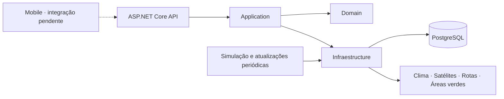

# 🌳 UrbanShade

### Inteligência climática para cidades mais habitáveis

**Global Solution 2026/2 — FIAP | Engenharia de Software**

> Dados ambientais para compreender o calor urbano e apoiar decisões sobre cidades mais confortáveis.

[Visão geral](#-sobre-o-projeto) · [Backend](#-backend-implementado) · [Execução](#-como-executar) · [Documentação](#-documentação-técnica) · [Uso de IA](#-uso-de-inteligência-artificial--declaração-fiap)

---

## 📖 Sobre o projeto

O **UrbanShade** é uma plataforma de inteligência climática urbana desenvolvida para monitorar condições ambientais, identificar áreas com maior exposição ao calor e apoiar gestores públicos no planejamento de intervenções urbanas.

A solução combina sensores simulados, meteorologia, dados geográficos e análises térmicas. Também oferece recursos no backend para comparar rotas a pé considerando as condições ambientais disponíveis.

O projeto integra a **Global Solution 2026/2 da FIAP**, com o tema *CitizenTech — Tecnologia com o cidadão no centro da inovação*.

## 🎯 Problema e público-alvo

A impermeabilização do solo e a redução da cobertura vegetal contribuem para ilhas de calor. A exposição afeta especialmente idosos, crianças, trabalhadores ao ar livre e pedestres.

O UrbanShade busca apoiar **prefeituras e gestores públicos** na identificação de regiões que precisam de atenção e oferecer aos **cidadãos** acesso às condições ambientais e à comparação de deslocamentos. O modelo de negócio proposto é **B2G — Business to Government**.

## 📌 Estado da entrega

| Frente | Situação no repositório |
| --- | --- |
| Backend | Implementado em ASP.NET Core, com autenticação, serviços ambientais, análises e rotas |
| Persistência | PostgreSQL, Entity Framework Core e migrations |
| Testes | Suítes de validadores, casos de uso e API disponíveis |
| Mobile | Base Expo/React Native criada; telas de negócio e integração ainda pendentes |
| Serviços externos | Dependem das credenciais, configurações e dados disponíveis no ambiente |
| Entrega acadêmica | Validação com usuários, evidências e vídeo pitch devem ser consolidados pela equipe |

A implementação do backend não implica que todas as integrações externas estejam habilitadas ou que as funcionalidades já estejam disponíveis no aplicativo.

## ⚙️ Backend implementado

| Módulo | Recursos |
| --- | --- |
| Autenticação | Cadastro, login, renovação de tokens, encerramento de sessão e gerenciamento de senha |
| Organizações | Gestão de instituições, vínculos e fluxo de primeiro acesso |
| Cidades e regiões | Cadastro, consultas e delimitação geográfica |
| Sensores | Gestão de sensores, simulação de temperatura e umidade e histórico de leituras |
| Meteorologia | Condições atuais, previsão e histórico com integração Open-Meteo |
| Análise térmica | Indicadores por sensor e região, mapas, histórico, ranking e comparação |
| Geoprocessamento | Integração com dados de satélite e áreas verdes, conforme configuração |
| Rotas | Comparação de trajetos a pé com critérios ambientais |
| Painel institucional | Consultas e indicadores para acompanhamento das regiões |

Os contratos completos, parâmetros e permissões estão nos [controladores da API](Backend/src/Backend/UrbanShade.API/Controllers) e no Swagger do ambiente de desenvolvimento.

### Critérios ambientais

A análise térmica regional combina condições térmicas, temperatura de superfície e vegetação, considerando validade, qualidade e procedência das fontes. Histórico não significa dado atual: resultados podem perder validade e deixar de ser elegíveis para recomendações.

Os dados de sensores de demonstração são **simulados**. Integrações meteorológicas e geográficas dependem de seus provedores e configurações. Consulte a documentação técnica para as regras de cada análise.

## 🏗️ Arquitetura e tecnologias

O backend é um monólito organizado em camadas, com separação entre API, casos de uso, domínio e infraestrutura.



| Camada | Tecnologias |
| --- | --- |
| API | C# / ASP.NET Core / .NET 10 |
| Persistência | PostgreSQL / Entity Framework Core |
| Autenticação | JWT, refresh tokens e políticas de autorização |
| Documentação | Swagger / OpenAPI |
| Mobile | Expo 58 / React Native 0.88 / React 19.3 / TypeScript |
| Navegação | Expo Router |
| Integrações | Open-Meteo, Google Earth Engine, OpenStreetMap e OpenRouteService |
| Testes | xUnit e Testcontainers nas suítes HTTP |

### Organização do repositório

```text
Projeto/
├── Architeture/                # Materiais de arquitetura
├── Backend/
│   ├── src/Backend/            # API, Application, Domain e Infraestructure
│   ├── src/Shared/             # Contratos de comunicação e exceções
│   ├── src/Docs/               # Documentação técnica
│   ├── tests/                  # Validadores, casos de uso e API
│   └── UrbanShade.slnx         # Solução .NET
├── Mobile/                    # Aplicativo Expo / React Native
└── readme.md
```

O [domínio](Backend/src/Backend/UrbanShade.Domain/Entities) inclui usuários, sessões, organizações, cidades, regiões geográficas, sensores, leituras, análises térmicas, dados meteorológicos, análises de satélite e áreas verdes.

## 🚀 Como executar

### Backend

Pré-requisitos: **SDK .NET 10**, PostgreSQL acessível e configurações locais do ambiente. Para as suítes que usam Testcontainers, é necessário um ambiente Docker compatível.

1. Prepare o banco e consulte [`Backend/example.env`](Backend/example.env) e [`docker-compose.yaml`](Backend/docker-compose.yaml) para a configuração local.
2. Forneça a conexão `ConnectionStrings__DbConnection` e a chave `Jwt__SigningKey` por configuração segura do ambiente.
3. Configure as integrações habilitadas. O roteamento exige a configuração do OpenRouteService; as demais integrações também possuem opções próprias.
4. Na raiz do repositório, execute:

```bash
dotnet restore Backend/UrbanShade.slnx
dotnet run --project Backend/src/Backend/UrbanShade.API --launch-profile http
```

**API local:** `http://localhost:5289`

**Swagger:** `http://localhost:5289/swagger`

Em `Development` e `Tests`, o startup executa migrations e prepara sensores de demonstração. Nos demais ambientes, as migrations devem ser aplicadas previamente com uma identidade de implantação separada. Veja o [guia de segurança e execução](Backend/src/Docs/seguranca-e-execucao.md).

### Mobile

Com Node.js e npm compatíveis com as dependências instalados:

```bash
cd Mobile
npm ci
npm start
```

O projeto também oferece `npm run android`, `npm run ios` e `npm run web`. O simulador local de iOS requer macOS. A base atual ainda apresenta as telas iniciais do Expo; o cliente HTTP, a autenticação e as telas ambientais serão integrados à API na etapa mobile.

### Testes

Na raiz do repositório:

```bash
dotnet test Backend/UrbanShade.slnx
```

As suítes HTTP utilizam bancos descartáveis em Testcontainers. Serviços externos reais exigem ativação explícita. A existência das suítes não substitui o registro das evidências de execução para a entrega acadêmica.

## 🔐 Segurança

O backend implementa autenticação JWT, controle de sessões com refresh tokens, autorização por políticas, validação de entradas e limites de requisições. O fluxo institucional inclui troca de senha no primeiro acesso.

Credenciais e chaves devem ser configuradas fora do repositório. Consulte o [guia de segurança](Backend/src/Docs/seguranca-e-execucao.md) para contratos de autenticação, limitações e requisitos de banco em produção.

## 📚 Documentação técnica

- [Segurança e execução](Backend/src/Docs/seguranca-e-execucao.md)
- [Instituições e primeiro acesso](Backend/src/Docs/fluxo-instituicoes-primeiro-acesso.md)
- [Municípios e análise térmica](Backend/src/Docs/municipios-e-analise-termica.md)
- [Regiões e consultas geoespaciais](Backend/src/Docs/regioes-e-consultas-geoespaciais.md)
- [Integração com satélites](Backend/src/Docs/integracao-satelites.md)
- [Áreas verdes e OpenStreetMap](Backend/src/Docs/areas-verdes-openstreetmap.md)

## 🌎 Impacto esperado

O projeto se relaciona aos **ODS 3 — Saúde e Bem-Estar**, **11 — Cidades e Comunidades Sustentáveis** e **13 — Ação Contra a Mudança Global do Clima**, ao apoiar o acesso a informações ambientais e decisões de adaptação ao calor urbano.

O impacto esperado é ampliar a visibilidade das condições locais e apoiar investimentos em infraestrutura verde. Reduções efetivas de temperatura dependem de intervenções físicas e medições posteriores.

**Prazo de entrega acadêmica:** 19 de novembro de 2026, às 23h55.

## 🤖 Uso de inteligência artificial — declaração FIAP

O **OpenAI Codex foi utilizado para suporte técnico, revisão de código e aumento da produtividade** durante o desenvolvimento do UrbanShade, conforme a exigência de transparência da FIAP.

A ferramenta apoiou a compreensão e organização do código, a identificação de possíveis melhorias e a elaboração e revisão da documentação. As decisões técnicas, a validação das sugestões e a responsabilidade pela entrega final permanecem com os integrantes do projeto.

## 👨‍💻 Equipe

**FIAP — Engenharia de Software | Turma 3ESOA**

*Equipe:*
- **[Victor Hugo Porfirio](https://www.linkedin.com/in/porfiriovitin/)** — Backend / Banco de Dados
- **[Daniel Ribeiro](https://www.linkedin.com/in/daniel0ribeiro/)** — Backend / Frontend
- **[Mabel Krüger de Souza](https://www.linkedin.com/in/mabel-kr%C3%BCger-de-souza-546773111/)** — Frontend / UX

---

*Projeto acadêmico desenvolvido para a Global Solution 2026/2 — CitizenTech.*